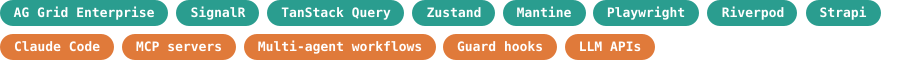

  

  
  
  

### Hi, I'm Myko 👋

Senior Frontend Engineer with 6+ years of React and TypeScript, mostly on data-heavy B2B products. My core is the frontend: big real-time grids, performance work, and rewriting legacy code without stopping releases. I also ship fullstack features on .NET and Node.js with AI agents, through a multi-agent Claude Code workflow I designed and use every day.

### What I'm working on

- 🖥️ Owning the frontend of **Beacon52**, a port-call platform used by Stolt-Nielsen, Neste, E&S Tankers and Christiania Shipping. About 90 live AG Grid screens over SignalR; cold boot went from 2.9 s to 0.25 s.
- 🔁 Led the **Bunker Suite** frontend rewrite: every module rebuilt on a new architecture in parallel with production, switched over in January 2026.
- 🤖 Running a **multi-agent Claude Code workflow**: 13 implementer, reviewer and QA agents with 21 guard hooks that take a ticket to a reviewed pull request. About 750 commits have gone through it in four months.
- 📱 Building **Flutter** apps for an emergency-response platform, including live SOS audio through a Kotlin plugin over Azure Communication Services.

### Stack

   
   
  

### Selected work

| Product | What it is | My part |
|---|---|---|
| **[Beacon52](https://www.beacon52.com)** | Port-call management SaaS | Frontend owner: shared AG Grid and SignalR layer behind ~90 grids, performance pass, React 18 and TypeScript migration, Playwright E2E from scratch, 1,200+ PRs reviewed |
| **[Bunker Suite](https://www.bunkersuite.com)** | Marine-fuel trading SaaS | Led the frontend rewrite (Mantine, Zustand, React Hook Form); TypeScript coverage from 38% to 85%; real-time trading grids; .NET features on EF Core |
| **CYSafe** | Emergency-response (SOS) platform | Co-built two Flutter apps and a React admin console from week one; live SOS audio end to end; SOS lifecycle and real-time updates |
| **[Furlux](https://t.me/OneLove_okuliary_bot)** | Wholesale eyewear store inside Telegram | Built end to end: React 19 Mini App, Strapi 5 admin with CSV import and PDF/Excel export, Telegraf bot. In daily use |
| **Local Infusion CRM** | Insurance-verification CRM for a US infusion-therapy network | Live call status over Socket.IO, payer API with webhooks, case locking, CI/CD to 7 environments |
| **Company websites** | [verdemarine.com](https://www.verdemarine.com), [lovebanus.com](https://www.lovebanus.com) | Next.js and Directus; launched Verde Marine from an empty repo in about five weeks |

### Side projects

- 🧩 **[NotchDeck](https://github.com/MykhailoMishchenko/notchdeck)**: turns the MacBook notch into a widget dock with a Dynamic Island, media, calendar, a file buffer, fan control through a privileged helper, and Claude usage limits. Swift and SwiftUI.
- ⚽ **[Gaffer](https://wc2026-analytics.vercel.app)**: AI analyst for the 2026 World Cup. Claude broke down every match and priced 109 picks against bookmaker odds with an adaptive Kelly criterion on a paper bankroll. It came back from a 20% drawdown to finish in profit (+4.1%, ROI 2.8%, positive closing-line value) and beat a human opponent by about 4,000 credits. The predecessor of Pitwall.
- 🏁 **[Pitwall](https://github.com/MykhailoMishchenko/pitwall)**: Formula 1 analytics built on Gaffer's engine: Claude is the analyst and plays F1 Fantasy and Predict against real people, learning from every race weekend. React, Hono, TanStack Query.
- 🛠️ **[AI Website Builder](https://github.com/MykhailoMishchenko/ai-website-builder)**: prompt-to-app builder where agents generate Next.js projects inside cloud sandboxes. Next.js 15, tRPC, Inngest AgentKit, E2B, Prisma.
- 📊 **[Dashboard](https://github.com/MykhailoMishchenko/dashboard)**: reference setup for an AG Grid server-side row model fed by TanStack Query, with AG Charts.

Open to senior frontend, fullstack and mobile roles, remote, full-time or contract.

